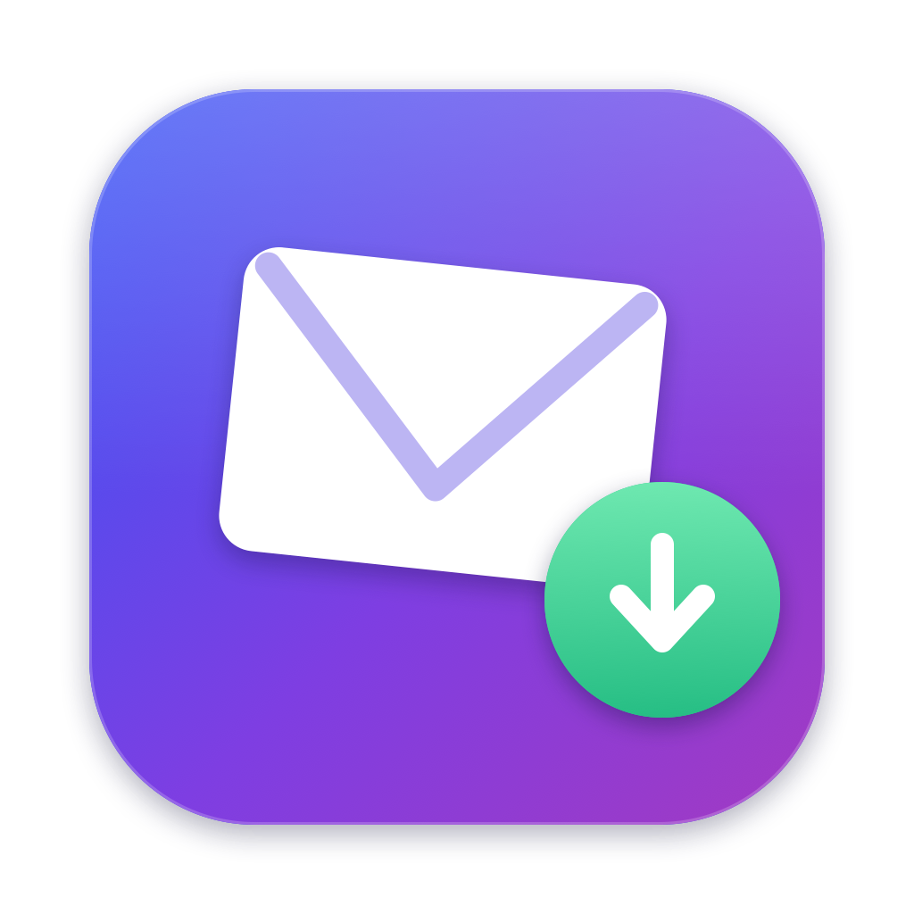

<p align="center">
  
</p>

<h1 align="center">MailSink</h1>

<p align="center">让 macOS 别再把「点邮箱地址」变成「打开邮件 App」。</p>

---

在网页、PDF、备忘录、聊天窗口里点一下邮箱地址，macOS 就把 `mailto:` 链接
交给 Apple Mail：弹出写信窗口、抢走焦点、开始收信。系统设置里根本没有
「不处理 mailto:」这个选项，唯一的切换入口还藏在 Mail 自己的偏好设置里。

MailSink 用大约 200 行代码接下这个差事：收到 `mailto:` 链接时，把收件人地址
复制到剪贴板、弹一条简短通知，然后退出。不打开任何邮件客户端，也不会发出任何邮件。

English: [README.md](README.md)

## 它到底做什么

| | |
|---|---|
| 在任何地方点邮箱地址 | 地址被复制到剪贴板 |
| 通知 | 「邮箱地址已复制 — 没有打开任何邮件客户端」 |
| 邮件 App | 永不启动 |
| 后台常驻 | 无，进程存活约 0.4 秒即退出 |
| 联网 | 无 |
| Dock 图标 / 菜单栏图标 | 都没有 |

`mailto:alice@example.com,bob@example.com?subject=Hi` 会变成
`alice@example.com, bob@example.com` —— 多个收件人全部保留，`subject`/`body`
等参数丢弃。

## 环境要求

- macOS 12 及以上（Apple Silicon / Intel 均可）
- Xcode Command Line Tools：`xcode-select --install`

App 是在你自己的 Mac 上从源码编译的，使用 ad-hoc 签名，不会有 Gatekeeper 拦截；
本项目不提供预编译二进制。

## 安装

```sh
git clone https://github.com/iuhw/mailsink.git
cd mailsink
make install
```

这一步会构建 `~/Applications/MailSink.app`、注册到 Launch Services，并把
`mailto:` 的处理权交给它。

验证：

```sh
open 'mailto:hello@example.com'   # 剪贴板里应该出现 hello@example.com
```

## 常用命令

```sh
APP=~/Applications/MailSink.app/Contents/MacOS/MailSink

$APP --check          # 当前谁在处理 mailto:
$APP --install        # 重新接管（Mail 更新后可能被抢回去）
$APP --uninstall      # 把 mailto: 交还 Apple Mail
$APP --quiet off      # 关闭通知
$APP --help
```

对应 `make install`、`make check`、`make uninstall`。

## 卸载

```sh
make uninstall        # 交还 Apple Mail 并删除 App
```

不会留下任何东西：没有启动项、没有登录项、除 `io.github.iuhw.mailsink`
这一个偏好域外不写入任何文件。

## 实现原理

1. `Info.plist` 里用 `CFBundleURLTypes` 声明自己支持 `mailto` scheme，从而具备成为
   URL handler 的资格。
2. `LSSetDefaultHandlerForURLScheme("mailto", "io.github.iuhw.mailsink")` 让系统把
   链接指向 MailSink。
3. macOS 以 Apple Event（`kInternetEventClass` / `kAEGetURL`）投递链接；App 解析出
   收件人、写入 `NSPasteboard`、调用 `osascript` 发通知，然后退出。
4. `LSUIElement = true`，所以没有 Dock 图标，也不出现在切换器里。

## 常见问题

**安全吗？会不会读我的邮件？**
没有账号、没有特殊权限、没有任何网络代码。全部逻辑就在
`Sources/MailSink.swift` 一个文件里，可以直接读完。

**Mail 更新后又被抢回去了？**
重跑 `make install`（或 `--install`）。用 `--check` 可以确认当前状态。

**我想改成在浏览器里开 Gmail。**
暂不支持。Chrome / Firefox 可以各自注册 `mailto:` handler，能覆盖「网页里点击」
这一种场景；`--mode gmail` 在后续计划里。

**为什么不干脆删掉 Mail.app？**
它是系统 App，删不掉。清空里面的账户只能保证误开时是个空窗口。

**会影响「共享 → 邮件」或通讯录吗？**
这些同样走 `mailto:`，行为一致：复制地址，而不是弹写信窗口。

## 同类工具

如果你更想把 `mailto:` 交给网页版邮箱，或者每次点击都想自己挑客户端，可以看看
[Velja](https://sindresorhus.com/velja) 或 Bumpr。MailSink 刻意做得很窄：只干一件事。

## 许可

[MIT](LICENSE)
